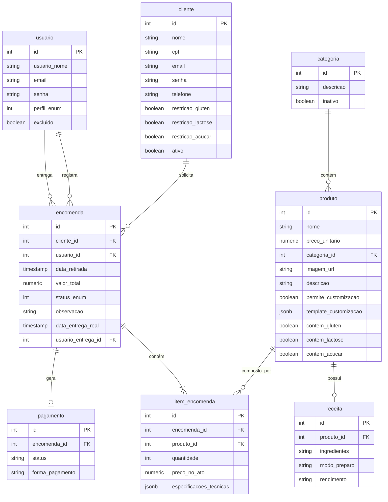

# Especificação de Requisitos de Software (ERS)
## Documentação do Banco de Dados - SGEP (Panificadora Sabor de Mel)

Esta seção da documentação detalha a estrutura do banco de dados relacional (PostgreSQL) do **SGEP**, contendo o Diagrama de Entidade-Relacionamento (DER), o dicionário de dados de todas as tabelas com seus respectivos campos e tipos, e a descrição detalhada das relações e chaves.

---

## 1. Diagrama de Entidade-Relacionamento (DER)

Abaixo está o modelo conceitual de relações entre as tabelas do sistema:

---

## 2. Dicionário de Dados (Tabelas e Variáveis)

### 2.1. Tabela: `usuario`
Armazena as informações dos funcionários e administradores que acessam o painel de gerenciamento do sistema.

| Nome do Campo | Tipo de Dado | Restrições / Chaves | Descrição |
| :--- | :--- | :--- | :--- |
| `id` | SERIAL / INT | PK, NOT NULL | Identificador único do usuário. |
| `usuario_nome` | VARCHAR / TEXT | NOT NULL | Nome completo do usuário funcionário/administrador. |
| `email` | VARCHAR / TEXT | NOT NULL, UNIQUE | Endereço de e-mail utilizado para autenticação no sistema. |
| `senha` | VARCHAR / TEXT | NOT NULL | Hash criptografado (BCrypt) da senha do usuário. |
| `perfil_enum` | INTEGER | NOT NULL | Perfil de acesso do usuário: • `0`: Admin (Administrador) • `1`: Funcionario (Funcionário comum) |
| `excluido` | BOOLEAN | NOT NULL, DEFAULT false | Flag para exclusão lógica. Se `true`, o usuário está inativo/removido. |

---

### 2.2. Tabela: `cliente`
Armazena os dados cadastrais dos clientes, incluindo informações de login (para o portal do cliente) e restrições alimentares.

| Nome do Campo | Tipo de Dado | Restrições / Chaves | Descrição |
| :--- | :--- | :--- | :--- |
| `id` | SERIAL / INT | PK, NOT NULL | Identificador único do cliente. |
| `nome` | VARCHAR / TEXT | NOT NULL | Nome completo do cliente. |
| `cpf` | VARCHAR / TEXT | NULLABLE | Cadastro de Pessoa Física do cliente (usado para emissão e pagamentos). |
| `email` | VARCHAR / TEXT | NULLABLE, UNIQUE | E-mail para contato e login na plataforma. |
| `senha` | VARCHAR / TEXT | NULLABLE | Hash criptografado (BCrypt) da senha (nulo se o cliente for cadastrado apenas por telefone). |
| `telefone` | VARCHAR / TEXT | NULLABLE | Telefone/WhatsApp do cliente para aviso de encomendas. |
| `restricao_gluten` | BOOLEAN | NOT NULL, DEFAULT false | Indica se o cliente possui restrição alimentar a glúten. |
| `restricao_lactose`| BOOLEAN | NOT NULL, DEFAULT false | Indica se o cliente possui restrição alimentar a lactose. |
| `restricao_acucar` | BOOLEAN | NOT NULL, DEFAULT false | Indica se o cliente possui restrição a açúcar (ex: diabéticos). |
| `ativo` | BOOLEAN | NOT NULL, DEFAULT true | Flag para exclusão lógica/inatividade do cliente. |

---

### 2.3. Tabela: `categoria`
Agrupa os produtos em categorias lógicas (ex: Pães, Doces, Bolos de Festa).

| Nome do Campo | Tipo de Dado | Restrições / Chaves | Descrição |
| :--- | :--- | :--- | :--- |
| `id` | SERIAL / INT | PK, NOT NULL | Identificador único da categoria. |
| `descricao` | VARCHAR / TEXT | NOT NULL | Nome descritivo da categoria. |
| `inativo` | BOOLEAN | NOT NULL, DEFAULT false | Indica se a categoria foi desativada no sistema. |

---

### 2.4. Tabela: `produto`
Armazena o catálogo de produtos ofertados pela panificadora Sabor de Mel.

| Nome do Campo | Tipo de Dado | Restrições / Chaves | Descrição |
| :--- | :--- | :--- | :--- |
| `id` | SERIAL / INT | PK, NOT NULL | Identificador único do produto. |
| `nome` | VARCHAR / TEXT | NOT NULL | Nome comercial do produto. |
| `preco_unitario` | NUMERIC(10,2) | NOT NULL | Preço base cobrado por unidade/kg do produto. |
| `categoria_id` | INTEGER | FK, NOT NULL | ID da categoria (`categoria.id`). |
| `imagem_url` | VARCHAR / TEXT | NULLABLE | URL da imagem ilustrativa do produto. |
| `descricao` | VARCHAR / TEXT | NULLABLE | Descrição ou detalhamento dos ingredientes principais e apresentação. |
| `permite_customizacao`| BOOLEAN | NOT NULL, DEFAULT false | Determina se o produto permite opções de personalização pelo cliente. |
| `template_customizacao`| JSONB | NULLABLE | Estrutura JSON que dita as opções dinâmicas de customização (ex: sabores, coberturas). |
| `contem_gluten` | BOOLEAN | NOT NULL, DEFAULT true | Indica se a fórmula padrão do produto contém glúten. |
| `contem_lactose` | BOOLEAN | NOT NULL, DEFAULT true | Indica se a fórmula padrão do produto contém lactose. |
| `contem_acucar` | BOOLEAN | NOT NULL, DEFAULT true | Indica se a fórmula padrão do produto contém açúcar. |

---

### 2.5. Tabela: `receita`
Guarda as instruções internas de fabricação associadas a cada produto. Acesso restrito a confeiteiros/padeiros.

| Nome do Campo | Tipo de Dado | Restrições / Chaves | Descrição |
| :--- | :--- | :--- | :--- |
| `id` | SERIAL / INT | PK, NOT NULL | Identificador único da receita. |
| `produto_id` | INTEGER | FK, NOT NULL, UNIQUE| ID do produto associado (`produto.id`). |
| `ingredientes` | VARCHAR / TEXT | NULLABLE | Lista de insumos e quantidades necessárias. |
| `modo_preparo` | VARCHAR / TEXT | NULLABLE | Modo de preparo passo a passo. |
| `rendimento` | VARCHAR / TEXT | NULLABLE | Rendimento estimado da receita (ex: "Rende 1 bolo de 2kg", "20 pãezinhos"). |

---

### 2.6. Tabela: `encomenda`
Representa o cabeçalho do pedido de encomenda feito por um cliente, gerenciando as datas e a entrega.

| Nome do Campo | Tipo de Dado | Restrições / Chaves | Descrição |
| :--- | :--- | :--- | :--- |
| `id` | SERIAL / INT | PK, NOT NULL | Identificador único da encomenda. |
| `cliente_id` | INTEGER | FK, NULLABLE | ID do cliente solicitante (`cliente.id`). Pode ser nulo se o cliente for avulso. |
| `usuario_id` | INTEGER | FK, NULLABLE | ID do funcionário que registrou a encomenda (`usuario.id`). |
| `data_retirada` | TIMESTAMP | NOT NULL | Data e hora agendada para a retirada da encomenda na loja. |
| `valor_total` | NUMERIC(10,2) | NOT NULL | Valor total cobrado pela encomenda inteira. |
| `status_enum` | INTEGER | NOT NULL | Status de progresso da encomenda: • `0`: Pendente • `1`: Em Andamento (Produção) • `2`: Concluída (Pronta para retirada) • `3`: Cancelada • `4`: Entregue |
| `observacao` | VARCHAR / TEXT | NULLABLE | Observações gerais sobre a encomenda (ex: "Embalar para presente"). |
| `data_entrega_real`| TIMESTAMP | NULLABLE | Data e hora exatas da entrega/retirada efetiva. |
| `usuario_entrega_id`| INTEGER | FK, NULLABLE | ID do funcionário que efetuou a entrega (`usuario.id`). |

---

### 2.7. Tabela: `item_encomenda`
Gerencia a lista de produtos contidos em cada encomenda (tabela de junção N:N com atributos adicionais).

| Nome do Campo | Tipo de Dado | Restrições / Chaves | Descrição |
| :--- | :--- | :--- | :--- |
| `id` | SERIAL / INT | PK, NOT NULL | Identificador único do item da encomenda. |
| `encomenda_id` | INTEGER | FK, NOT NULL | ID da encomenda correspondente (`encomenda.id`) - Deleção em Cascata. |
| `produto_id` | INTEGER | FK, NOT NULL | ID do produto inserido (`produto.id`). |
| `quantidade` | INTEGER | NOT NULL | Quantidade solicitada deste produto na encomenda. |
| `preco_no_ato` | NUMERIC(10,2) | NOT NULL | Preço unitário praticado na compra. Garante a integridade histórica caso o preço do produto mude. |
| `especificacoes_tecnicas`| JSONB | NULLABLE | Opções de customização salvas para este item específico da encomenda (ex: "Frase do bolo: Parabéns Higor", "Massa de Chocolate"). |

---

### 2.8. Tabela: `pagamento`
Controla a situação financeira de cada encomenda, registrando a forma de pagamento do sinal ou do saldo.

| Nome do Campo | Tipo de Dado | Restrições / Chaves | Descrição |
| :--- | :--- | :--- | :--- |
| `id` | SERIAL / INT | PK, NOT NULL | Identificador único do registro de pagamento. |
| `encomenda_id` | INTEGER | FK, NOT NULL | ID da encomenda associada (`encomenda.id`) - Deleção em Cascata. |
| `status` | VARCHAR(50) | NOT NULL, DEFAULT 'pendente' | Situação do pagamento (ex: `'pendente'`, `'pago'`, `'cancelado'`). |
| `forma_pagamento`| VARCHAR(100) | NOT NULL, DEFAULT 'Não informada' | Forma como o pagamento foi/está sendo realizado (ex: `'Pix'`, `'Dinheiro'`, `'Cartão de Crédito'`). |

---

## 3. Descrição Detalhada das Relações e Cardinalidades

1. **`categoria` → `produto` (1:N)**:
   * Uma **categoria** pode conter múltiplos **produtos**. 
   * Um **produto** obrigatoriamente pertence a exatamente uma **categoria** (`categoria_id` referenciando `categoria(id)`).

2. **`produto` ↔ `receita` (1:1)**:
   * Um **produto** possui no máximo uma **receita** associada.
   * Uma **receita** é exclusiva de um único **produto** (`produto_id` referenciando `produto(id)` com restrição `UNIQUE`).

3. **`cliente` → `encomenda` (1:N)**:
   * Um **cliente** cadastrado pode fazer zero ou múltiplas **encomendas**.
   * Uma **encomenda** pode estar associada a um **cliente** cadastrado (`cliente_id` referenciando `cliente(id)`), ou pode ser criada com `cliente_id = NULL` (cliente avulso/não cadastrado).

4. **`usuario` → `encomenda` (1:N)**:
   * Um **usuario** (funcionário/administrador) pode registrar zero ou múltiplas **encomendas** (`usuario_id` referenciando `usuario(id)`).
   * Um **usuario** também pode entregar zero ou múltiplas **encomendas** (`usuario_entrega_id` referenciando `usuario(id)`).

5. **`encomenda` → `item_encomenda` (1:N)**:
   * Uma **encomenda** é composta por um ou mais itens (`item_encomenda`). A remoção de uma encomenda remove em cascata todos os seus itens associados.

6. **`produto` → `item_encomenda` (1:N)**:
   * Um **produto** pode aparecer como item em diversas encomendas (`produto_id` referenciando `produto(id)`).

7. **`encomenda` ↔ `pagamento` (1:1 na prática)**:
   * Cada **encomenda** gera um registro na tabela **pagamento** para controle do fluxo de caixa e status financeiro (`encomenda_id` referenciando `encomenda(id)` com exclusão em cascata).
