# Especificação de Requisitos de Software (ERS)
## Documentação do Banco de Dados — SGEP (Panificadora e Mercado Sabor de Mel)

**Versão de Entrega Final — Estágio Supervisionado FIPP/Unoeste (02/2026)**  
**Aluno:** Higor Germano Cerqueira · **Orientadora:** Carolina Dias Chaves Corvetto

Esta documentação detalha a estrutura consolidada do banco de dados relacional **PostgreSQL** do **SGEP**, contendo o Diagrama Entidade-Relacionamento (DER), o dicionário de dados completo de todas as tabelas e a descrição das relações e restrições de integridade referencial, em total conformidade com o script [`init.sql`](file:///Users/germano/Documents/SGEP/init.sql) e com o inicializador automático [`DatabaseInitializer.cs`](file:///Users/germano/Documents/SGEP/BackEnd/BackEnd/Repository/DatabaseInitializer.cs).

---

## 1. Diagrama Entidade-Relacionamento (DER)

```mermaid
erDiagram
    usuario {
        int id PK
        varchar usuario_nome
        varchar email UK
        varchar senha
        int perfil_enum
        boolean excluido
    }

    cliente {
        int id PK
        varchar nome
        varchar cpf UK
        varchar email UK
        varchar senha
        varchar telefone
        boolean restricao_gluten
        boolean restricao_lactose
        boolean restricao_acucar
        boolean ativo
        boolean bloqueado_encomendas
        varchar motivo_bloqueio
    }

    token_autenticacao {
        int id PK
        int cliente_id
        varchar codigo_token
        varchar tipo_token
        timestamp data_expiracao
        boolean utilizado
        timestamp data_criacao
    }

    categoria {
        int id PK
        varchar descricao
        boolean inativo
    }

    produto {
        int id PK
        varchar nome
        numeric preco_unitario
        int categoria_id FK
        varchar imagem_url
        text descricao
        boolean permite_customizacao
        jsonb template_customizacao
        boolean contem_gluten
        boolean contem_lactose
        boolean contem_acucar
    }

    receita {
        int id PK
        int produto_id FK
        text ingredientes
        text modo_preparo
        varchar rendimento
    }

    encomenda {
        int id PK
        int cliente_id FK
        int usuario_id FK
        timestamp data_retirada
        numeric valor_total
        int status_enum
        text observacao
        timestamp data_entrega_real
        int usuario_entrega_id FK
    }

    item_encomenda {
        int id PK
        int encomenda_id FK
        int produto_id FK
        int quantidade
        numeric preco_no_ato
        jsonb especificacoes_tecnicas
    }

    caixa {
        int id PK
        timestamp data_abertura
        numeric valor_inicial
        varchar status
        timestamp data_fechamento
        numeric valor_final
    }

    pagamento {
        int id PK
        int encomenda_id FK
        int caixa_id FK
        numeric valor_total
        numeric valor_sinal
        numeric saldo_devedor
        varchar forma_pagamento_sinal
        varchar status
        varchar forma_pagamento
        varchar preference_id
        bigint mp_payment_id
        timestamp data_criacao
    }

    categoria ||--o{ produto : "classifica"
    produto ||--o| receita : "possui"
    cliente ||--o{ encomenda : "solicita"
    cliente ||--o{ token_autenticacao : "valida_conta"
    usuario ||--o{ token_autenticacao : "recupera_senha"
    usuario ||--o{ encomenda : "registra"
    usuario ||--o{ encomenda : "entrega"
    encomenda ||--|{ item_encomenda : "compoe"
    produto ||--o{ item_encomenda : "referenciado_em"
    encomenda ||--o| pagamento : "gera"
    caixa ||--o{ pagamento : "vincula_opcional"
```

---

## 2. Dicionário de Dados Completo

### 2.1. Tabela: `usuario` (Funções F1 e F6)
Armazena administradores e funcionários internos que operam o painel administrativo e operacional.

| Nome do Campo | Tipo de Dado | Restrições / Chaves | Descrição |
| :--- | :--- | :--- | :--- |
| `id` | `SERIAL` | `PK, NOT NULL` | Identificador único do operador interno. |
| `usuario_nome` | `VARCHAR(255)` | `NOT NULL` | Nome completo do administrador ou funcionário. |
| `email` | `VARCHAR(255)` | `NOT NULL, UNIQUE` | E-mail único utilizado para login e recuperação de senha. |
| `senha` | `VARCHAR(255)` | `NOT NULL` | Hash criptografado (`BCrypt`) da senha de acesso. |
| `perfil_enum` | `INTEGER` | `NOT NULL` | Nível de acesso: • `0`: Administrador (acesso total) • `1`: Funcionário (produção, receitas, retirada e histórico) |
| `excluido` | `BOOLEAN` | `NOT NULL, DEFAULT FALSE` | Flag de exclusão lógica para preservar auditoria de encomendas. |

---

### 2.2. Tabela: `cliente` (Funções F2, F9, F11 e F18)
Armazena dados cadastrais dos clientes (CRM), restrições de segurança alimentar e controle de bloqueio por inadimplência.

| Nome do Campo | Tipo de Dado | Restrições / Chaves | Descrição |
| :--- | :--- | :--- | :--- |
| `id` | `SERIAL` | `PK, NOT NULL` | Identificador único do cliente. |
| `nome` | `VARCHAR(255)` | `NOT NULL` | Nome completo do cliente. |
| `cpf` | `VARCHAR(14)` | `UNIQUE, NULLABLE` | CPF do cliente usado para identificação, cobrança e consulta de inadimplência. |
| `email` | `VARCHAR(255)` | `UNIQUE, NULLABLE` | E-mail utilizado para login no portal e envio de tokens de segurança. |
| `senha` | `VARCHAR(255)` | `NULLABLE` | Hash criptografado (`BCrypt`) da senha de acesso ao portal. |
| `telefone` | `VARCHAR(20)` | `NULLABLE` | Telefone/WhatsApp para contato sobre encomendas. |
| `restricao_gluten` | `BOOLEAN` | `NOT NULL, DEFAULT FALSE` | Sinaliza restrição alimentar a glúten (doença celíaca/intolerância). |
| `restricao_lactose` | `BOOLEAN` | `NOT NULL, DEFAULT FALSE` | Sinaliza intolerância/alergia à lactose. |
| `restricao_acucar` | `BOOLEAN` | `NOT NULL, DEFAULT FALSE` | Sinaliza restrição ao consumo de açúcar (ex.: diabetes). |
| `ativo` | `BOOLEAN` | `NOT NULL, DEFAULT TRUE` | Flag de exclusão lógica (*soft delete* / LGPD). |
| `bloqueado_encomendas` | `BOOLEAN` | `NOT NULL, DEFAULT FALSE` | Indica bloqueio administrativo/automático para novos pedidos online. |
| `motivo_bloqueio` | `VARCHAR(255)` | `NULLABLE` | Justificativa registrada pela administração em caso de bloqueio. |

---

### 2.3. Tabela: `token_autenticacao` (Função F18)
Gerencia os códigos numéricos temporários de 6 dígitos enviados por e-mail para recuperação de senha, alteração de perfil e exclusão de conta.

| Nome do Campo | Tipo de Dado | Restrições / Chaves | Descrição |
| :--- | :--- | :--- | :--- |
| `id` | `SERIAL` | `PK, NOT NULL` | Identificador único do token gerado. |
| `cliente_id` | `INTEGER` | `NOT NULL` | Identificador do titular (`> 0` para `cliente.id`; `< 0` para `-usuario.id` na recuperação de senha de operadores). |
| `codigo_token` | `VARCHAR(6)` | `NOT NULL` | Código numérico aleatório de 6 dígitos enviado por e-mail. |
| `tipo_token` | `VARCHAR(50)` | `NOT NULL` | Finalidade: `'RECUPERACAO_SENHA'`, `'ALTERACAO_PERFIL'` ou `'EXCLUSAO_CONTA'`. |
| `data_expiracao` | `TIMESTAMP` | `NOT NULL` | Data/hora limite de validade em UTC (15 minutos após emissão). |
| `utilizado` | `BOOLEAN` | `NOT NULL, DEFAULT FALSE` | Indica se o código já foi consumido ou invalidado por nova solicitação. |
| `data_criacao` | `TIMESTAMP` | `DEFAULT NOW() UTC` | Data/hora de geração do token para auditoria. |

---

### 2.4. Tabela: `categoria` (Função F3)
Agrupa os itens comercializados pela panificadora em seções do catálogo.

| Nome do Campo | Tipo de Dado | Restrições / Chaves | Descrição |
| :--- | :--- | :--- | :--- |
| `id` | `SERIAL` | `PK, NOT NULL` | Identificador único da categoria. |
| `descricao` | `VARCHAR(255)` | `NOT NULL` | Nome da categoria (ex.: *Bolos de Festa*, *Pães*, *Salgados*). |
| `inativo` | `BOOLEAN` | `NOT NULL, DEFAULT FALSE` | Flag de inativação lógica quando há produtos vinculados. |

---

### 2.5. Tabela: `produto` (Funções F4, F8 e F9)
Armazena o catálogo comercial, preços, alérgenos e templates dinâmicos de customização.

| Nome do Campo | Tipo de Dado | Restrições / Chaves | Descrição |
| :--- | :--- | :--- | :--- |
| `id` | `SERIAL` | `PK, NOT NULL` | Identificador único do produto. |
| `nome` | `VARCHAR(255)` | `NOT NULL` | Nome comercial do produto. |
| `preco_unitario` | `NUMERIC(10,2)` | `NOT NULL` | Preço unitário base em reais (`R$`). |
| `categoria_id` | `INTEGER` | `FK, NOT NULL` | Referência obrigatória para `categoria(id)`. |
| `imagem_url` | `VARCHAR(2048)` | `NULLABLE` | URL da foto comercial exibida na Vitrine Digital e gestão. |
| `descricao` | `TEXT` | `NULLABLE` | Descrição pública do produto para o catálogo. |
| `permite_customizacao` | `BOOLEAN` | `NOT NULL, DEFAULT FALSE` | Define se o item exige/permite especificações personalizadas no pedido. |
| `template_customizacao` | `JSONB` | `NULLABLE` | Lista JSON de campos solicitados na encomenda (ex.: `["Massa", "Recheio", "Frase"]`). |
| `contem_gluten` | `BOOLEAN` | `NOT NULL, DEFAULT TRUE` | Indica presença de glúten na composição. |
| `contem_lactose` | `BOOLEAN` | `NOT NULL, DEFAULT TRUE` | Indica presença de lactose na composição. |
| `contem_acucar` | `BOOLEAN` | `NOT NULL, DEFAULT TRUE` | Indica presença de açúcar na composição. |

---

### 2.6. Tabela: `receita` (Funções F5 e F6)
Guarda a ficha técnica confidencial de fabricação própria (acesso exclusivo à equipe interna).

| Nome do Campo | Tipo de Dado | Restrições / Chaves | Descrição |
| :--- | :--- | :--- | :--- |
| `id` | `SERIAL` | `PK, NOT NULL` | Identificador único da ficha técnica. |
| `produto_id` | `INTEGER` | `FK, NOT NULL, UNIQUE` | Referência exclusiva `1:1` para `produto(id)` (`ON DELETE CASCADE`). |
| `ingredientes` | `TEXT` | `NULLABLE` | Insumos e proporções da receita. |
| `modo_preparo` | `TEXT` | `NULLABLE` | Instruções passo a passo de preparo para padaria/confeitaria. |
| `rendimento` | `VARCHAR(255)` | `NULLABLE` | Rendimento estimado (ex.: *1 bolo de 2 kg*, *100 unidades*). |

---

### 2.7. Tabela: `encomenda` (Funções F7, F12, F13, F14, F15 e F16)
Cabeçalho do pedido agendado, controlando prazos, valores, fase de produção e auditoria de retirada.

| Nome do Campo | Tipo de Dado | Restrições / Chaves | Descrição |
| :--- | :--- | :--- | :--- |
| `id` | `SERIAL` | `PK, NOT NULL` | Número identificador único da encomenda. |
| `cliente_id` | `INTEGER` | `FK, NULLABLE` | Cliente solicitante (`cliente.id`). |
| `usuario_id` | `INTEGER` | `FK, NULLABLE` | Operador interno que lançou a encomenda (`usuario.id`), quando aplicável. |
| `data_retirada` | `TIMESTAMP` | `NOT NULL` | Data e horário agendados para retirada na panificadora. |
| `valor_total` | `NUMERIC(10,2)` | `NOT NULL` | Soma calculada no servidor a partir dos itens da encomenda. |
| `status_enum` | `INTEGER` | `NOT NULL, DEFAULT 0` | Estado atual: • `0`: Pendente • `1`: Em Andamento (Em Produção) • `2`: Concluída (Pronta para Retirada) • `3`: Cancelada • `4`: Entregue |
| `observacao` | `TEXT` | `NULLABLE` | Observações gerais do pedido. |
| `data_entrega_real` | `TIMESTAMP` | `NULLABLE` | Data e hora exatas em que o pedido foi retirado no balcão. |
| `usuario_entrega_id` | `INTEGER` | `FK, NULLABLE` | Funcionário responsável pela entrega física (`usuario.id`). |

---

### 2.8. Tabela: `item_encomenda` (Funções F7, F8 e F12)
Itens que compõem cada encomenda, preservando preço histórico e especificações técnicas em `JSONB`.

| Nome do Campo | Tipo de Dado | Restrições / Chaves | Descrição |
| :--- | :--- | :--- | :--- |
| `id` | `SERIAL` | `PK, NOT NULL` | Identificador único da linha de item. |
| `encomenda_id` | `INTEGER` | `FK, NOT NULL` | Referência para `encomenda(id)` (`ON DELETE CASCADE`). |
| `produto_id` | `INTEGER` | `FK, NOT NULL` | Referência para `produto(id)`. |
| `quantidade` | `INTEGER` | `NOT NULL, CHECK (> 0)` | Quantidade encomendada do produto. |
| `preco_no_ato` | `NUMERIC(10,2)` | `NOT NULL` | Preço unitário vigente no momento da compra (integridade histórica). |
| `especificacoes_tecnicas` | `JSONB` | `NULLABLE` | Detalhes personalizados escolhidos pelo cliente para este item. |

---

### 2.9. Tabela: `pagamento` (Funções F10, F11, F17, F19 e F20)
Controla o ciclo financeiro completo da encomenda, integrando pagamentos online via **Mercado Pago Checkout Pro** e pagamentos presenciais liquidados no **Balcão**.

| Nome do Campo | Tipo de Dado | Restrições / Chaves | Descrição |
| :--- | :--- | :--- | :--- |
| `id` | `SERIAL` | `PK, NOT NULL` | Identificador único do registro financeiro. |
| `encomenda_id` | `INTEGER` | `FK, NOT NULL` | Encomenda vinculada (`encomenda.id`, `ON DELETE CASCADE`). |
| `caixa_id` | `INTEGER` | `FK, NULLABLE` | Vínculo opcional com `caixa(id)`. |
| `valor_total` | `NUMERIC(10,2)` | `DEFAULT 0.00` | Valor integral da encomenda. |
| `valor_sinal` | `NUMERIC(10,2)` | `DEFAULT 0.00` | Valor de entrada/sinal pago antecipadamente, quando aplicável. |
| `saldo_devedor` | `NUMERIC(10,2)` | `DEFAULT 0.00` | Valor restante em aberto a ser quitado na retirada no balcão. |
| `forma_pagamento_sinal` | `VARCHAR(100)` | `NULLABLE` | Meio utilizado no pagamento do sinal. |
| `status` | `VARCHAR(50)` | `NOT NULL, DEFAULT 'pendente'` | Situação financeira: `'pendente'`, `'sinal_pago'`, `'pago'` ou `'cancelado'`. |
| `forma_pagamento` | `VARCHAR(100)` | `DEFAULT 'Não informada'` | Meio de pagamento principal/final (ex.: *Mercado Pago (Pix)*, *Dinheiro*, *Cartão*). |
| `preference_id` | `VARCHAR(255)` | `NULLABLE` | Identificador da preferência gerada na API do Mercado Pago. |
| `mp_payment_id` | `BIGINT` | `NULLABLE` | Identificador único da transação aprovada no Mercado Pago. |
| `data_criacao` | `TIMESTAMP` | `DEFAULT NOW() UTC` | Data/hora do registro financeiro. |

---

### 2.10. Tabela Auxiliar: `caixa`
Tabela auxiliar de apoio para integridade referencial opcional (`pagamento.caixa_id`).

| Nome do Campo | Tipo de Dado | Restrições / Chaves | Descrição |
| :--- | :--- | :--- | :--- |
| `id` | `SERIAL` | `PK, NOT NULL` | Identificador do turno de caixa. |
| `data_abertura` | `TIMESTAMP` | `NOT NULL, DEFAULT CURRENT_TIMESTAMP` | Data/hora de abertura. |
| `valor_inicial` | `NUMERIC(10,2)` | `NOT NULL` | Fundo de troco inicial. |
| `status` | `VARCHAR(50)` | `NOT NULL, DEFAULT 'Aberto'` | Situação (`'Aberto'` ou `'Fechado'`). |
| `data_fechamento` | `TIMESTAMP` | `NULLABLE` | Data/hora de encerramento. |
| `valor_final` | `NUMERIC(10,2)` | `NULLABLE` | Saldo final apurado. |

---

## 3. Relações e Regras de Integridade Referencial

1. **`categoria` (1) → (N) `produto`**: Todo produto pertence obrigatoriamente a uma categoria; categorias com produtos vinculados sofrem apenas inativação lógica (`inativo = TRUE`).
2. **`produto` (1) ↔ (0..1) `receita`**: Relação `1:1` garantida pela restrição `UNIQUE` em `receita.produto_id`, com `ON DELETE CASCADE`.
3. **`cliente` (1) → (N) `encomenda`**: Vincula cada encomenda ao cadastro do cliente para rastreamento de restrições alimentares e histórico financeiro por CPF.
4. **`cliente` / `usuario` (1) → (N) `token_autenticacao`**: Registra os tokens temporários de 6 dígitos para operações sensíveis de conta (validade de 15 minutos e invalidação automática de tokens anteriores).
5. **`usuario` (1) → (N) `encomenda`**: Duplo relacionamento rastreando quem registrou (`usuario_id`) e quem entregou (`usuario_entrega_id`) cada pedido.
6. **`encomenda` (1) → (N) `item_encomenda`**: Composição forte (`ON DELETE CASCADE`), armazenando `preco_no_ato` e `especificacoes_tecnicas` em `JSONB`.
7. **`encomenda` (1) ↔ (1) `pagamento`**: Controla o status de quitação online (Mercado Pago) ou presencial (Balcão), bloqueando a entrega final caso haja pendência financeira não liquidada.
